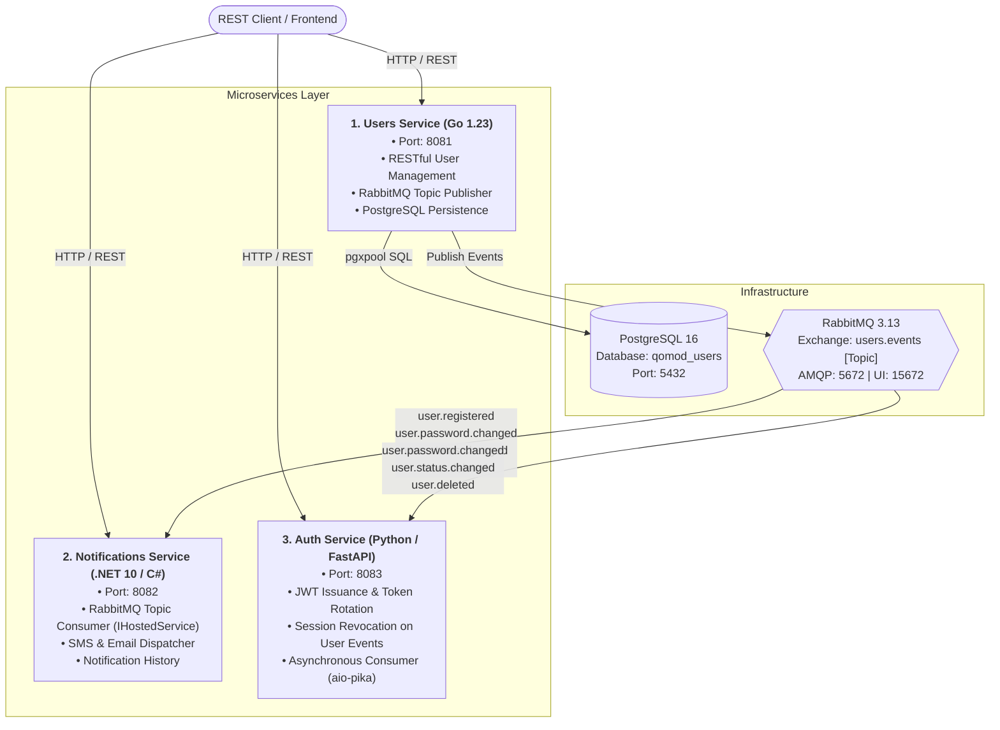

# Qomod: Multi-Stack Microservices Architecture

A polyglot microservices ecosystem communicating asynchronously through **RabbitMQ (Topic Exchange)** with independent databases and runtimes.

---

## 🏗️ Architecture & Stack Overview



---

## 📊 Services Matrix

| Microservice | Technology Stack | Port | Primary Responsibility | Data Store / Broker Interaction |
|---|---|---|---|---|
| **`users`** | **Golang 1.23** (Chi, pgx/v5) | `8081` | User registration, profile updates, account status lifecycle | PostgreSQL 16 (reads/writes) + Publishes to RabbitMQ exchange `users.events` |
| **`notifications`** | **.NET 10 (C#)** (ASP.NET Core, RabbitMQ.Client 7) | `8082` | Background event consumption, SMS & Email notifications | Consumes from RabbitMQ queue `notifications.user-events.queue` |
| **`auth`** | **Python 3.12+** (FastAPI, PyJWT, aio-pika) | `8083` | JWT issuance, password check, session tracking & real-time revocation | Consumes from RabbitMQ queue `auth.user-events.queue` to invalidate sessions |

---

## 📨 RabbitMQ Event Topics & Flow

All events originate from the **Users** microservice and follow a standardized CloudEvents-inspired envelope:

```json
{
  "event_id": "9b1deb4d-3b7d-4bad-9bdd-2b0d7b3dcb6d",
  "event_type": "user.registered",
  "aggregate_type": "user",
  "aggregate_id": "c1f2e3d4-5678-90ab-cdef-1234567890ab",
  "timestamp": "2026-10-15T00:55:00Z",
  "version": "1.0",
  "data": { ... }
}
```

### Event Interaction Matrix

| Routing Key | Emitted By | Consumer: `notifications` (.NET) Action | Consumer: `auth` (Python) Action |
|---|---|---|---|
| **`user.registered`** | Users (Go) | Dispatches Welcome SMS to cellphone & Welcome Email | — |
| **`user.profile.updated`** | Users (Go) | *(Optional)* Profile change notification | — |
| **`user.password.changed`** | Users (Go) | Dispatches Security Alert SMS to user | **Immediately invalidates all existing user JWT sessions & refresh tokens** |
| **`user.status.changed`** | Users (Go) | Dispatches Status Notice SMS (e.g. Account suspended) | If status != `enabled`, **revokes all active sessions** |
| **`user.deleted`** | Users (Go) | Dispatches Account Deletion Notice SMS | **Revokes all user tokens and blacklists future sessions** |

---

## ⚡ Quickstart & Testing

### 1. Start Infrastructure (Postgres & RabbitMQ)
```bash
make dev-deps
```
- **Postgres**: `localhost:5432` (`user: postgres`, `password: postgres`)
- **RabbitMQ**: `localhost:5672`
- **RabbitMQ Management Dashboard**: http://localhost:15672 (`guest` / `guest`)

### 2. Run All Tests Across All 3 Stacks
```bash
make test-all
```
This runs:
- `cd services/users && go test -v -race ./...` (Go race detector)
- `dotnet test services/notifications.tests` (.NET xUnit tests)
- `cd services/auth && .venv/bin/pytest -v` (Python pytest)

---

## 📡 Complete REST API Guide

### 1. Users Microservice (Go — `http://localhost:8081`)

#### Register a User
```bash
curl -X POST http://localhost:8081/api/v1/users \
  -H "Content-Type: application/json" \
  -d '{
    "cellphone_number": "+12025550199",
    "first_name": "Jane",
    "last_name": "Doe",
    "birthdate": "1994-08-20",
    "email": "jane.doe@example.com",
    "password": "StrongPassword123!"
  }'
```

#### Change Password (Triggers Real-time Event to Notifications & Auth)
```bash
curl -X PUT http://localhost:8081/api/v1/users/<USER_ID>/password \
  -H "Content-Type: application/json" \
  -d '{
    "old_password": "StrongPassword123!",
    "new_password": "BrandNewSecretPassword456!"
  }'
```

#### Change Status (Triggers Real-time Revocation in Auth)
```bash
curl -X PATCH http://localhost:8081/api/v1/users/<USER_ID>/status \
  -H "Content-Type: application/json" \
  -d '{
    "status": "suspended"
  }'
```

---

### 2. Notifications Microservice (.NET — `http://localhost:8082`)

#### View Dispatched Notification Log
```bash
curl http://localhost:8082/api/notifications
```

#### View Notifications for Specific User
```bash
curl http://localhost:8082/api/notifications/user/<USER_ID>
```

#### Send Test Notification (Manual Trigger)
```bash
curl -X POST http://localhost:8082/api/notifications/test \
  -H "Content-Type: application/json" \
  -d '{
    "phone": "+12025550199",
    "message": "Manual test notification"
  }'
```

---

### 3. Auth Microservice (Python — `http://localhost:8083`)

#### Login (Obtain JWT Access & Refresh Tokens)
```bash
curl -X POST http://localhost:8083/api/v1/auth/login \
  -H "Content-Type: application/json" \
  -d '{
    "cellphone_number": "+12025550199",
    "password": "StrongPassword123!"
  }'
```

#### Verify Token Authenticity & Revocation
```bash
curl -X POST http://localhost:8083/api/v1/auth/verify \
  -H "Content-Type: application/json" \
  -d '{
    "token": "<ACCESS_TOKEN>"
  }'
```

#### Access Protected Endpoint (`/me`)
```bash
curl http://localhost:8083/api/v1/auth/me \
  -H "Authorization: Bearer <ACCESS_TOKEN>"
```

#### Refresh Token (Rotate Tokens)
```bash
curl -X POST http://localhost:8083/api/v1/auth/refresh \
  -H "Content-Type: application/json" \
  -d '{
    "refresh_token": "<REFRESH_TOKEN>"
  }'
```

#### Logout (Revoke Session)
```bash
curl -X POST http://localhost:8083/api/v1/auth/logout \
  -H "Authorization: Bearer <ACCESS_TOKEN>" \
  -H "Content-Type: application/json" \
  -d '{
    "refresh_token": "<REFRESH_TOKEN>"
  }'
```
